# Research Computing Training


## Presentor

Khurshid Shaymardanov

HPC Systems Engineer

[Research Computing](https://rc.northeastern.edu/research-computing-team/)

---

# Checkpointing on the Cluster: Make Your Jobs Restartable
---

## Table of content

[1. Opening story: the GPU node incident](#1-opening-story-the-gpu-node-incident)

[2. Why checkpoint?](#2-why-checkpoint)

[3. The four checkpointing types (taxonomy)](#3-the-four-checkpointing-types-taxonomy)

[4. Pre-flight discipline: profile, dry-run, estimate VRAM](#4-pre-flight-discipline-profile-dry-run-estimate-vram)

[5. Slurm mechanics + job patterns (serial, loop/vector, array, MPI)](#5-slurm-mechanics-job-patterns-serial-loopvector-array-mpi)

[6. ML model-level checkpointing (PyTorch, TensorFlow)](#6-mlmodel-level-checkpointing-pytorch-tensorflow)

[6.1. Beyond ML and MD: find your software (strategy families)](#6.1-beyond-ml-and-md-find-your-software-strategy-families)

[6.2. Open OnDemand users: interactive sessions](#6.2-open-ondemand-users-interactive-sessions)

[7. Storage and I/O hygiene](#7-storage-and-io-hygiene)

[8. Checklist + live demo + support](#8-checklist-live-demo-support)

[9. Q&A](#9-q&a)

[10. References](#10-references)

[11. Appendix A - Per-application checkpoint reference (handout)](#11-appendix-a-i-per-application-checkpoint-reference-handout)

[12. Appendix B - Hands-on practice labs (after the talk)](#12-appendix-b-i-hands-on-practice-labs-after-the-talk)


## 1. Opening story: the GPU node incident (4 min)

The recent debugging case: a GPU node went into an error state, and the root cause turned out to be **the user's code, not the hardware**:

1. **Symptom** — the node errored and the job (and possibly others on the node) died; hours of compute were lost.
2. **Diagnosis** — XID errors and job-data correlation pointed at the workload rather than a faulty GPU.
3. **Lesson** — none of the lost work needed to be lost. A profiled, dry-run, memory-estimated job with checkpoints would have either (a) never hit the failure, or (b) resumed from the last checkpoint after the node was drained.

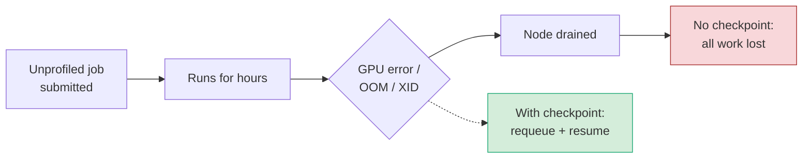

---

## 2. Why checkpoint? (3 min)

- **Wall-time limits** — no job runs forever; long work must be split.
- **Failures** — node faults, GPU XID errors, network blips, power events.
- **Preemption** — jobs on preemptible/scavenger partitions can be stopped at any time.
- **Faster starts** — shorter restartable jobs fit into backfill gaps and start sooner than one 7-day monolith. They can also run on less-contended GPUs (e.g., older generations sitting idle) instead of queueing for the newest ones.
- **Reproducibility and debugging** — a checkpoint lets you resume from just before a bug or divergence.

---

## 3. The four checkpointing types (7 min)

The source material lists four types. Define them crisply, because "user-level" is the most commonly confused term. In the HPC literature, *user-level* means a **transparent tool running in user space** (no root, no code changes) — not "the user writes their own save code."

| Type | Who saves state? | Code changes? | Examples | Recommended for |
|------|------------------|---------------|----------|-----------------|
| **Application-level** | The application itself, built in | None — just enable it | GROMACS, LAMMPS, VASP, OpenFOAM, MATLAB `save`, R `saveRDS` | Default choice whenever available |
| **Model-level** (ML) | Your training script via the framework | Small | PyTorch `state_dict`, TensorFlow `tf.train.Checkpoint` | All ML training |
| **User-level** (transparent, user space) | A library intercepts the process | None | DMTCP | Legacy/closed codes with no restart support |
| **System-level** (kernel/OS) | The OS snapshots the process | None | CRIU (+ NVIDIA `cuda-checkpoint` for GPU) | Admin-driven use cases; rarely user-facing |

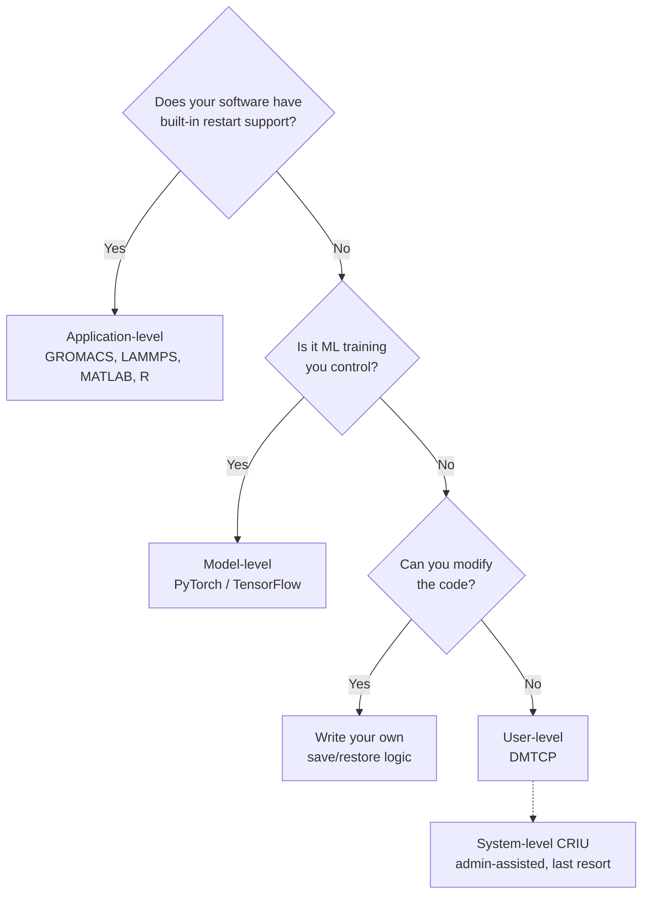

**Built-in support (from the source note):** PyTorch, TensorFlow, MATLAB and R all have native ways to save state, and many computational chemistry and molecular dynamics packages (GROMACS, LAMMPS) have built-in checkpoint options. The message: *check the manual before reaching for anything transparent.*

### 3a. User-level checkpointing with DMTCP — how it works

DMTCP wraps your program at launch. A coordinator process tracks all participating processes; on a checkpoint request (timer or manual), each process writes its memory, open files and thread state to an image file. Restart rebuilds the processes from those images.

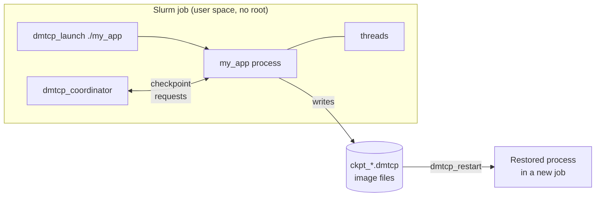

```bash
# First run: checkpoint every hour into a dedicated directory
dmtcp_launch --interval 3600 --ckptdir "$CKPT_DIR" ./my_app input.dat

# Later job: restart from the latest images
dmtcp_restart "$CKPT_DIR"/ckpt_*.dmtcp
```

**Best-practice caveats to state on the slide:**
- Images are a full memory dump, so they can be large — size your storage accordingly.
- MPI over InfiniBand and GPU processes are where transparent tools get fragile; prefer application-level checkpointing for those.
- Always test a restart before relying on it for a long run.

### 3b. System-level checkpointing with CRIU — how it works

CRIU (Checkpoint/Restore In Userspace) uses kernel interfaces to freeze a process tree and dump its full state. For GPU processes, NVIDIA's `cuda-checkpoint` first moves GPU memory and state into host memory so CRIU can capture it. This generally needs elevated privileges, which is why it is admin territory rather than a self-service tool.

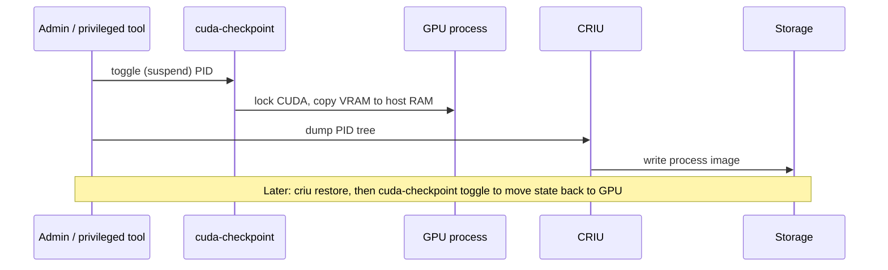
---

## 4. Pre-flight discipline: profile, dry-run, estimate VRAM (7 min)

This is the bridge from the opening story. Checkpointing protects you *after* something goes wrong; pre-flight checks keep things from going wrong at all. 

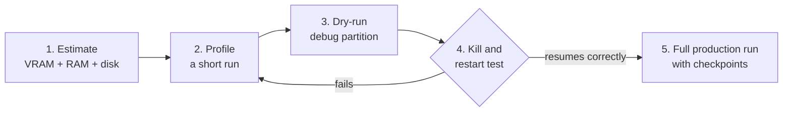

### 4a. Estimate GPU memory before you submit

Rough rules of thumb for transformer-style training (activations come on top and grow with batch size and sequence length):

| Workload | Approx. bytes per parameter | 7B-parameter example |
|----------|-----------------------------|----------------------|
| Inference, FP16/BF16 weights | ~2 | ~14 GB + KV cache |
| Full fine-tune, mixed precision + Adam | ~16 (weights, grads, FP32 master copy, 2 optimizer moments) | ~112 GB + activations |

The same numbers tell you **how big each checkpoint will be**: a full training checkpoint carries the optimizer state, so it is far larger than the model weights alone. This feeds directly into the storage section.

### 4b. Measure, don't guess

```python
import torch
torch.cuda.reset_peak_memory_stats()
# ... run a handful of training steps ...
print(f"Peak VRAM: {torch.cuda.max_memory_allocated() / 1e9:.1f} GB")
```

- `nvidia-smi` / DCGM for live utilization and memory.
- PyTorch memory snapshot (`torch.cuda.memory._record_memory_history`) for finding leaks and spikes.
- Nsight Systems for timeline profiling.
- `seff <jobid>` / `sacct` for CPU, RAM and time efficiency of finished jobs.

### 4c. Dry-run

Run 50–100 steps (or one short simulation segment) on a debug partition with a short time limit. Confirm three things: memory fits with headroom, a checkpoint is written, and a fresh job resumes from it correctly.

---

## 5. Slurm mechanics and job patterns (9 min)

### 5a. The core mechanism: signal before the wall

Slurm can send a signal a few minutes before the time limit. The batch script catches it, tells the application to save, and requeues itself.

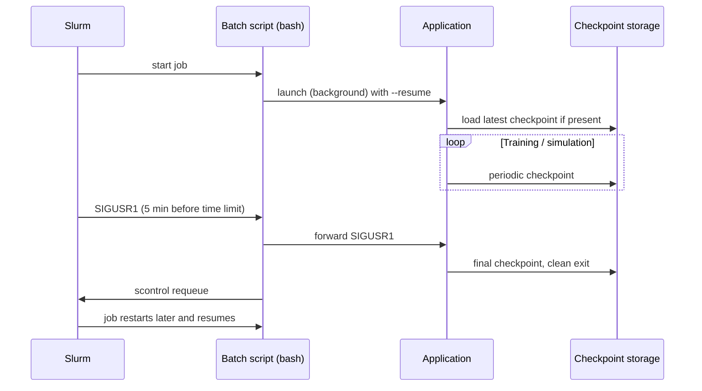

### 5b. Serial job template 

```bash
#!/bin/bash
#SBATCH --job-name=restartable
#SBATCH --time=04:00:00
#SBATCH --signal=B:USR1@300        # signal the batch shell 300 s before the limit
#SBATCH --requeue
#SBATCH --open-mode=append          # keep logs across restarts
#SBATCH --output=%x-%j.out

CKPT_DIR=/path/on/vast/$USER/$SLURM_JOB_NAME
mkdir -p "$CKPT_DIR"
echo "Start: restart count = ${SLURM_RESTART_COUNT:-0}"

handler() {
    echo "USR1 received at $(date); asking app to checkpoint"
    kill -USR1 "$APP_PID"
    wait "$APP_PID"
    scontrol requeue "$SLURM_JOB_ID"
}
trap handler USR1

# Run in the background so bash can react to the trap
python run.py --ckpt-dir "$CKPT_DIR" --resume &
APP_PID=$!
wait "$APP_PID"
```

Application side (Python):

```python
import signal
STOP = False
def on_usr1(signum, frame):
    global STOP
    STOP = True          # don't save inside the handler; save at the next safe point
signal.signal(signal.SIGUSR1, on_usr1)

for step in range(start_step, total_steps):
    do_work(step)
    if step % ckpt_every == 0 or STOP:
        save_checkpoint(step)
        if STOP:
            break
```

### 5c. "Vector" / loop-state checkpointing

Many scripts loop over a list of items (files, parameter values, vector elements). The simplest effective checkpoint is to record progress and skip finished work on restart.

```python
import json, os
state_file = "progress.json"
done = set(json.load(open(state_file))) if os.path.exists(state_file) else set()

for i, item in enumerate(items):
    if i in done:
        continue
    results = process(item)
    save_result(i, results)
    done.add(i)
    tmp = state_file + ".tmp"
    json.dump(sorted(done), open(tmp, "w"))
    os.replace(tmp, state_file)      # atomic update
```

> Speaker note: if your source material uses "vector checkpointing" to mean something more specific (e.g., saving NumPy/array state), adapt the example — the pattern of "save state, skip completed work, write atomically" still applies.

### 5d. Array jobs: two patterns

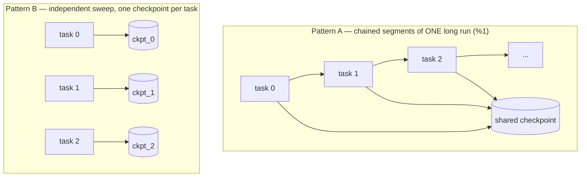

```bash
# Pattern A: 10 sequential 4-hour segments of one long run; %1 = one at a time
#SBATCH --array=0-9%1
#SBATCH --time=04:00:00
python run.py --ckpt-dir "$CKPT_DIR" --resume

# Pattern B: parameter sweep, each task checkpoints into its own directory
#SBATCH --array=0-49
CKPT_DIR=$BASE/ckpt_${SLURM_ARRAY_TASK_ID}
python run.py --param-index "$SLURM_ARRAY_TASK_ID" --ckpt-dir "$CKPT_DIR" --resume
```

Alternative to Pattern A: chain jobs with `sbatch --dependency=afterany:<jobid>` or `--dependency=singleton`.

### 5e. MPI jobs: GROMACS example

For MPI codes, application-level checkpointing is strongly preferred over transparent tools, because the application knows how to save a consistent global state across ranks.

```bash
#!/bin/bash
#SBATCH --nodes=2
#SBATCH --ntasks-per-node=4
#SBATCH --gpus-per-node=4
#SBATCH --time=24:00:00

# -cpi : continue from checkpoint if it exists
# -cpt : write a checkpoint every 15 minutes
# -maxh: stop cleanly just before the wall time (in hours)
srun gmx_mpi mdrun -deffnm md -cpi md.cpt -cpt 15 -maxh 23.8
```

`-maxh` is GROMACS's built-in version of the "signal before the wall" pattern. LAMMPS offers the same idea through its `restart` command (periodic restart files) and `read_restart` on the next job.

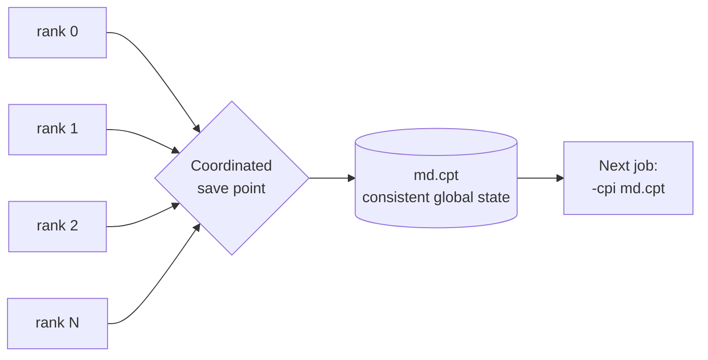

---

## 6. ML model-level checkpointing (7 min)

### 6a. Why it matters in deep learning

Training runs last hours to weeks, burn the most expensive GPUs, and are prone to OOMs, divergence and node faults. Checkpoints also let you keep the best model, roll back after a loss spike, and fine-tune later.

### 6b. What is the "state" in PyTorch?

The most common mistake is saving only the model weights.

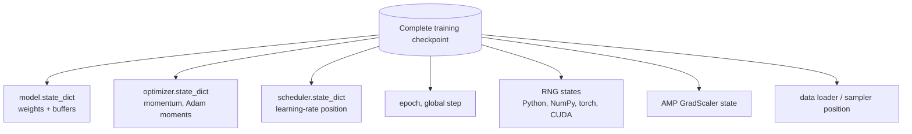

### 6c. Saving: `state_dict` vs entire model

| | `state_dict` (recommended) | Entire model (`torch.save(model)`) |
|---|---|---|
| What is stored | Tensors only | Pickled Python object, tied to your class definitions and file layout |
| Survives code refactors | Yes | Often breaks |
| Safe loading | Works with `weights_only=True` | Requires unpickling arbitrary code |

```python
import os, torch

def save_checkpoint(path, model, optimizer, scheduler, scaler, epoch, step):
    state = {
        "model": model.state_dict(),
        "optimizer": optimizer.state_dict(),
        "scheduler": scheduler.state_dict(),
        "scaler": scaler.state_dict(),
        "epoch": epoch,
        "step": step,
        "rng": {
            "torch": torch.get_rng_state(),
            "cuda": torch.cuda.get_rng_state_all(),
        },
    }
    tmp = path + ".tmp"
    torch.save(state, tmp)
    os.replace(tmp, path)            # atomic: never leaves a half-written checkpoint
```

### 6d. Loading and resuming training

```python
def load_checkpoint(path, model, optimizer, scheduler, scaler):
    if not os.path.exists(path):
        return 0, 0                  # fresh start
    ckpt = torch.load(path, map_location="cpu", weights_only=False)  # set True if you only stored tensors/primitives
    model.load_state_dict(ckpt["model"])
    optimizer.load_state_dict(ckpt["optimizer"])
    scheduler.load_state_dict(ckpt["scheduler"])
    scaler.load_state_dict(ckpt["scaler"])
    torch.set_rng_state(ckpt["rng"]["torch"])
    torch.cuda.set_rng_state_all(ckpt["rng"]["cuda"])
    return ckpt["epoch"], ckpt["step"]

start_epoch, start_step = load_checkpoint(CKPT, model, optimizer, scheduler, scaler)
```

**Distributed training notes:** with DDP, save from rank 0 only and call a barrier before others continue; for FSDP or very large models, use `torch.distributed.checkpoint` so each rank writes its own shard in parallel.

### 6e. TensorFlow / Keras example

```python
import tensorflow as tf

ckpt = tf.train.Checkpoint(step=tf.Variable(0), optimizer=optimizer, model=model)
manager = tf.train.CheckpointManager(ckpt, CKPT_DIR, max_to_keep=3)   # built-in rotation
ckpt.restore(manager.latest_checkpoint)                               # no-op on a fresh start

for batch in dataset:
    train_step(batch)
    ckpt.step.assign_add(1)
    if int(ckpt.step) % 500 == 0:
        manager.save()
```

For Keras `model.fit`, the `ModelCheckpoint` callback saves weights, and the `BackupAndRestore` callback is designed specifically for resuming interrupted training.

---

## 6.1. Beyond ML and MD: find your software (6 min)

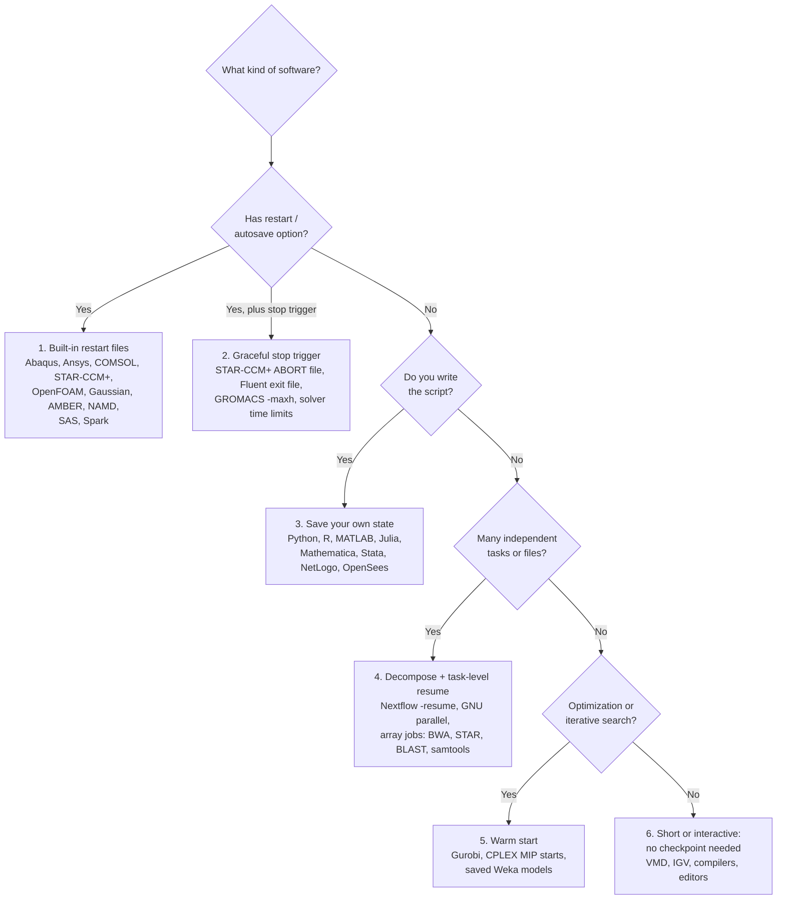

### Flagship example: stop-file trigger for commercial solvers

Several commercial codes don't react to Unix signals but do watch for a trigger file. Combine that with the Slurm signal from section 4: the trap creates the file, the solver saves and exits cleanly, and the job requeues.

```bash
#SBATCH --signal=B:USR1@600         # commercial solvers may need longer to write state
#SBATCH --requeue

handler() {
    touch ABORT                      # STAR-CCM+ default "Stop File" criterion name
    wait "$APP_PID"
    scontrol requeue "$SLURM_JOB_ID"
}
trap handler USR1

starccm+ -batch run -np "$SLURM_NTASKS" case.sim &
APP_PID=$!
wait "$APP_PID"
```

Make sure the simulation saves its `.sim` state when it stops (autosave or a save in the batch macro), so the requeued job resumes rather than starting over. Ansys Fluent has a comparable documented checkpoint/exit trigger-file mechanism; check your version's documentation for the file names and location.

### Flagship example: decompose and resume (bioinformatics)

Tools like BWA, Bowtie2, STAR, samtools, BLAST and FastQC have no internal checkpoint, but they don't need one: split the work into small units and let the workflow layer track what finished.

```bash
# Nextflow: completed tasks are cached in work/ and skipped on rerun
nextflow run main.nf -resume

# GNU parallel: log every task, rerun only what failed or never ran
parallel --joblog align.log --resume-failed \
  'bwa mem ref.fa {}_R1.fq.gz {}_R2.fq.gz | samtools sort -o {}.bam' ::: $(cat samples.txt)
```

Pre-calculation applies here too: build reference indexes (e.g., STAR `genomeGenerate`, BWA `index`) once in a separate job and reuse them, instead of rebuilding inside every alignment job.

### Flagship example: warm start for optimization (Gurobi / CPLEX)

MIP solvers cannot resume a branch-and-bound tree from disk, but they can restart from the best solution found so far. Set a time limit below the wall time, write the incumbent, and feed it back as a MIP start in the next job.

```python
import gurobipy as gp, os
m = gp.read("model.mps")
m.Params.TimeLimit = 3.8 * 3600          # stop before a 4-hour wall time
if os.path.exists("best.sol"):
    m.read("best.sol")                   # warm start from the previous run
m.optimize()
if m.SolCount > 0:
    m.write("best.sol")
```

### Licensed software caveat

For Abaqus, Ansys, COMSOL, STAR-CCM+, Lumerical, Gaussian, Schrödinger and similar, a requeued job must obtain license tokens again. If licenses are tracked in Slurm (`-L`/`--licenses`), the requeued job waits for tokens like any other; mention this so users aren't surprised by a delayed restart.

---

## 6.2. Open OnDemand users: interactive sessions (5 min)

Many users never write an `sbatch` script; they launch Jupyter, RStudio, MATLAB or a remote desktop (for COMSOL, Abaqus/CAE, STAR-CCM+, ParaView) from Open OnDemand. The key message: **an OnDemand session is a Slurm job too.** The hours you type into the form are its wall time, and when they run out the session is killed exactly like a batch job.

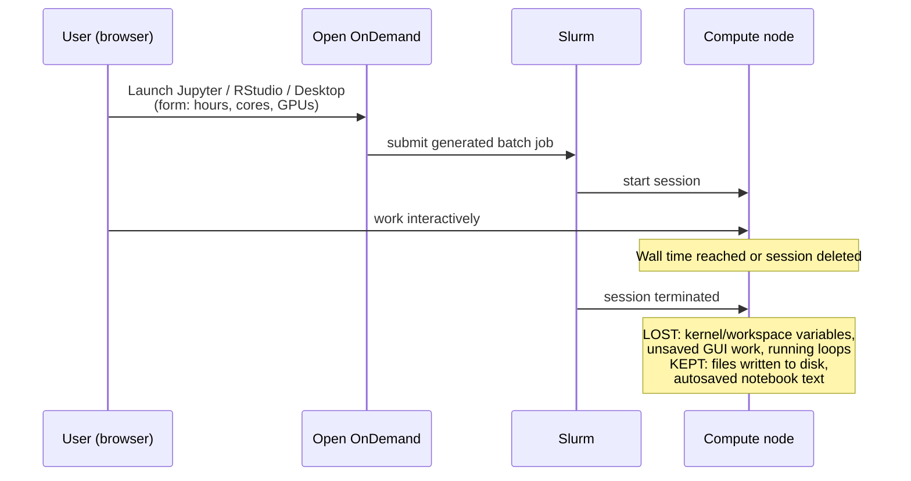

### What survives and what doesn't

| Item | Survives session end? | What to do |
|---|---|---|
| Notebook text/cells (`.ipynb`) | Mostly; Jupyter autosaves periodically | Save manually before long cells |
| Kernel variables, loaded models, DataFrames in memory | No | Write intermediate results to disk as you go |
| RStudio environment | Not reliably | `saveRDS` important objects; don't depend on `.RData` restore |
| MATLAB workspace in the GUI | No | `save` variables inside long loops |
| Unsaved COMSOL/Abaqus/STAR-CCM+ GUI model | No | Enable the application's autosave; save often |
| Files written to home/project/VAST | Yes | This is where checkpoints go |

### Pattern 1: save as you go, with a time-left check (Jupyter)

```python
import os, subprocess

def seconds_left():
    """Remaining wall time of the current Slurm job (OnDemand session or batch job)."""
    jid = os.environ.get("SLURM_JOB_ID")
    if not jid:
        return float("inf")
    out = subprocess.run(["squeue", "-h", "-j", jid, "-o", "%L"],
                         capture_output=True, text=True).stdout.strip()
    if not out or out in ("UNLIMITED", "NOT_SET", "INVALID"):
        return float("inf")
    days, _, hms = out.rpartition("-")
    parts = [int(p) for p in hms.split(":")]
    while len(parts) < 3:
        parts.insert(0, 0)
    h, m, s = parts
    return (int(days) if days else 0) * 86400 + h * 3600 + m * 60 + s

# inside a long loop:
if step % 100 == 0 or seconds_left() < 600:
    save_checkpoint(...)        # same atomic save as section 5c
```

### Pattern 2: develop interactively, run long work in batch

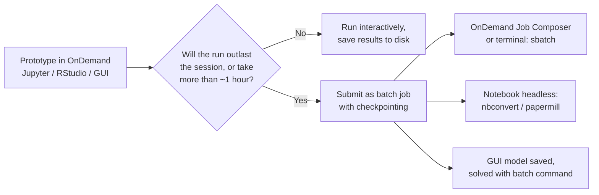

- **Notebooks headless:** `jupyter nbconvert --to notebook --execute --ExecutePreprocessor.timeout=-1 analysis.ipynb --output analysis-run.ipynb` inside an `sbatch` script (or `papermill` if installed, which also lets you pass parameters).
- **GUI applications:** build and save the model in the OnDemand desktop, then solve in batch: `comsol batch -inputfile model.mph -outputfile model_solved.mph`, Abaqus/CAE "Write Input" then `abaqus job=name` in an `sbatch` script, or `starccm+ -batch run case.sim`. The batch job then uses the checkpoint methods from section 5½.
- **Job Composer:** OnDemand's built-in job templates are the easiest path for users who avoid the terminal.

---

## 7. Storage and I/O hygiene (4 min)

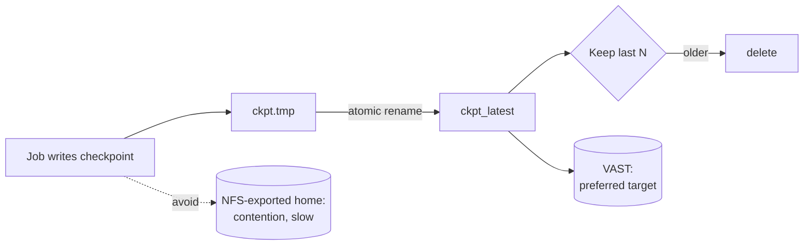

- **Where:** write checkpoints to the high-performance storage (VAST), not NFS-exported home directories, to avoid slowing everyone down.
- **Atomic writes:** write to a temp file, then rename — a crash mid-write must never destroy your only good checkpoint.
- **Rotation:** keep the last 2–3 plus any "best" checkpoint; don't keep every one.
- **Frequency:** the Young/Daly rule of thumb sets the interval at roughly √(2 × time-to-write-a-checkpoint × mean time between failures). In practice: checkpoint often enough that losing one interval doesn't hurt, but not so often that I/O dominates (aim for checkpoint time under ~5% of run time).
- **Large models:** consider asynchronous or sharded checkpointing so GPUs keep working while state is written.

---

## 8. Checklist and live demo (4 min)

**Before every long job:**
- [ ] Estimated VRAM, RAM and checkpoint size
- [ ] Profiled a short run; peak memory has headroom
- [ ] Dry-ran on the debug partition
- [ ] Killed the dry run and confirmed it resumes correctly
- [ ] Checkpoints go to VAST, written atomically, rotated
- [ ] Batch script uses `--signal`, a `trap`, and `--requeue` (or `-maxh` / array chaining)
- [ ] OnDemand users: results saved to disk as you go; long runs moved to batch jobs

**Live demo:**
- [ ] sbatch job for CLI with a counter script
- [ ] OOD based GUI jupyter job

**Support**

Email the Research Computing team at rchelp@northeastern.edu.

Come to office hours hosted on Teams.

Or book a consultation with an RC team member.

Review our Documentation.

---

## 9. Q&A (4 min)

*"A checkpoint you have never restarted from isn't a checkpoint."*

---

## 10. References

- Checkpointing, RTD: https://rc-docs.northeastern.edu/en/latest/best-practices/checkpointing.html#checkpointing-jobs
- Cuda, pytorch and virtual envitronment: https://rc-docs.northeastern.edu/en/latest/gpus/gpujobsubmission.html
- Estimating/calculating VRAM: 
- - https://developer.nvidia.com/blog/gpu-memory-essentials-for-ai-performance/
- - https://huggingface.co/docs/accelerate/en/usage_guides/model_size_estimator
- - https://skorppio.com/tools/vram-calculator-for-ai-ml


- - -


## 11. Appendix A: per-application checkpoint reference (handout)

Family numbers refer to section 5½. Exact syntax varies by version, so verify each entry against the documentation for the module version you provide, and test a restart before publishing it to users. Entries marked *verify* are ones where behavior differs notably across versions.

### Engineering, FEA and CFD

| Module | Family | How to checkpoint and resume |
|---|---|---|
| Abaqus/2023, 2024 | 1 | Add `*RESTART, WRITE, FREQUENCY=n` to the input. Resume in a new job with `*RESTART, READ` and `abaqus job=new oldjob=old`. Abaqus/Explicit can continue an interrupted run with `abaqus job=name recover`. |
| Ansys/2025R1 (Mechanical APDL) | 1 | Multiframe restart via `RESCONTROL`; resume with `ANTYPE,,RESTART` at a chosen load step/substep. |
| Ansys/2025R1 (Fluent) | 1, 2 | Autosave case/data at an iteration or time-step interval; restart by reading the latest case and data. Use the checkpoint/exit trigger files for a clean stop (*verify* names/location). |
| Ansys/2025R1 (CFX) | 1 | Backup results files at intervals; continue with `cfx5solve -def case.def -continue-from-file case_001.res` (*verify*). |
| comsol (6.0, 6.2 variants) | 1 | Time-dependent and parametric studies write recovery files; in batch mode continue from them with the recovery options (`-recover`, `-recoverydir`) (*verify* for your version). Alternatively save the solution and use it as the initial value of a follow-up study. |
| starccm+/18.02, 18.04 | 1, 2 | Auto Save by iteration or time step; "Stop File" criterion (default `ABORT`) or a maximum-elapsed-time criterion for clean stops; resume by running the saved `.sim`. |
| OpenFOAM/12 | 1 | In `controlDict`: `writeControl`/`writeInterval` for periodic writes, `purgeWrite` to keep only the last N time directories, `startFrom latestTime` to resume. |
| OpenSees/3.7.1 | 3 | Use the `database` command with `save`/`restore` tags inside the Tcl/Python script, or write your own state at analysis steps. |
| Lumerical/2025R1 | 4 | Don't rely on mid-simulation checkpoints (*verify* for your version); split parameter sweeps and optimizations into independent jobs or array tasks. |
| quantumatk/2026.03 | 1 | Molecular dynamics and geometry optimization accept a `CheckpointHandler(filename, interval)`; rerun pointing at the checkpoint to continue. |

### Chemistry, molecular dynamics and structural biology

| Module | Family | How to checkpoint and resume |
|---|---|---|
| gromacs/2024.3 | 1, 2 | `-cpt` interval, `-cpi state.cpt` to continue, `-maxh` to stop before the wall time (section 5e). |
| LAMMPS/29Aug2024 | 1 | `restart N file.*` or `write_restart`; next job uses `read_restart`. |
| AMBER/24 | 1 | `ntwr` controls restart-file frequency; continue with `-c previous.rst7` and `irest=1, ntx=5` in the mdin. |
| namd/2.14, 3.0.1 | 1 | `restartfreq`; continue with `bincoordinates`, `binvelocities`, `extendedSystem` from the `.restart.*` files and set `firsttimestep`. |
| plumed/2.10.0 | 1 | Add `RESTART` to `plumed.dat` so biases (e.g., metadynamics HILLS) append rather than restart from scratch; pair with the MD engine's own restart. |
| Tinker/8.11.3 | 1 | Dynamics writes a `.dyn` restart file automatically; rerunning with the same file names continues the trajectory. |
| gaussian/g16 | 1 | Always set `%Chk=`; keep `%RWF=` on persistent storage for long jobs. Restart with `Opt=Restart` or `Freq=Restart`, or reuse the checkpoint via `Guess=Read Geom=AllCheck`. |
| Molcas/25.06 | 1 | Keep the work directory on persistent storage; reuse `RunFile`/`JobIph` files to restart modules (*verify*). |
| schrodinger (2024-4 to 2026-3) | 1 | Desmond writes `.cpt` checkpoints and multisim workflows can be restarted; Jaguar supports restart files (*verify* flags per release). |
| EMAN2/2.99.47 | 5 | Refinements write per-iteration outputs; continue from the last completed iteration rather than restarting (*verify*). |
| VMD, OpenBabel | 6 | Interactive or short; no checkpoint needed. Script long VMD batch analyses with the loop-state pattern (5c). |

### Bioinformatics and genomics

| Module | Family | How to checkpoint and resume |
|---|---|---|
| nextflow/24.10, 25.04 | 4 | `-resume` skips cached tasks; keep the `work/` directory (on VAST, since it holds many small files). |
| bwa, bowtie2, star, samtools, bcftools, bedtools, bamtools, bbmap, trimmomatic, fastqc, vcftools | 4 | No internal checkpoint; split per sample, per chromosome, or per chunk and run via Nextflow, GNU parallel or array jobs. Build indexes once in a separate job. |
| blast/2.13.0 | 4 | Split the query FASTA into chunks and run as an array; merge results afterwards. |
| sratoolkit | 4 | `prefetch` can resume interrupted downloads; rerun skips completed accessions. |
| clustal/2.1 | 4 / 6 | Usually short; split large batches of alignments into independent tasks. |
| igv | 6 | Interactive; not applicable. |

### Statistics, data science, optimization and simulation languages

| Module | Family | How to checkpoint and resume |
|---|---|---|
| python, anaconda3, miniconda3, miniforge3 | 3 | `pickle`/`joblib`, NumPy `.npy`/`.npz`, HDF5 via `h5py`; loop-state pattern (5c); frameworks as in section 6. |
| R/4.4.1 | 3 | `saveRDS`/`readRDS` for intermediate objects; the `targets` package caches pipeline steps and skips completed ones. |
| matlab (R2023b to R2025b) | 3 | `save`/`load` inside loops; `matfile` for partial reads/writes of large variables. |
| julia/1.10.4 | 3 | `Serialization` standard library or JLD2 for saving state. |
| mathematica/14.1.0 | 3 | `DumpSave` and `Get` to save and reload definitions and results. |
| Stata/17 | 3 | `save` intermediate datasets, `estimates save` for results; loop-state pattern for long loops. |
| SAS/9.4 | 1 | Checkpoint mode for batch jobs: `-stepchkpt` (with `-steprestart` to resume); keep the WORK library across runs (`-noworkinit -noworkterm`) (*verify*). |
| gurobi/11, 12 and cplex/20.1 | 5 | Time limit below wall time, write incumbent (`.sol`/`.mst`), read it back as a MIP start next run. |
| spark/4.1.0 | 1 | `setCheckpointDir` plus `checkpoint()` on DataFrames/RDDs to truncate lineage; Structured Streaming uses `checkpointLocation`. |
| knime/5.3.1 | 1 | A saved workflow keeps executed nodes' results; re-execution runs only the nodes that didn't finish (*verify* in batch mode). |
| weka/3.8.6 | 5 | Save trained models with `-d model.model`, load with `-l`; training itself isn't resumable mid-run. |
| netlogo/6.4.0 | 3, 4 | `export-world`/`import-world` for model state; run BehaviorSpace experiments headless as independent array tasks. |
| GNU-parallel | 4 | `--joblog` with `--resume` or `--resume-failed`. |

### Visualization, media and data transfer

| Module | Family | How to checkpoint and resume |
|---|---|---|
| ParaView/5.13 (pvbatch) | 4 | Render one frame or time step per task; skip frames whose output already exists. |
| FFmpeg/7.1.1 | 4 | Encode in segments and concatenate; rerun only missing segments. |
| rclone/1.72.0 | 4 | Rerunning `rclone copy`/`sync` skips files already transferred. |

### Libraries, compilers and tools (family 6, or enablers)

Compilers, MPI stacks, CUDA/cuDNN/ROCm, math libraries (MKL, OpenBLAS, TBB, Boost), build tools (cmake, git, go, nodejs, perl, OpenJDK), editors (code-server, cursor-server) and profilers (Nsight, VTune) don't need checkpointing themselves. Two are worth highlighting as **enablers**: **HDF5** and **netCDF** are excellent formats for writing your own checkpoints (portable, self-describing, parallel I/O capable), and **Nsight**/**VTune** are the profiling tools for the pre-flight step in section 4.

---

## Appendix B: hands-on practice labs

Self-paced exercises for after the demo. Each lab is small, uses toy code where possible, and has a clear way to verify that the restart worked. **Test every lab on the cluster before publishing it** (module names, binary names such as `gmx` vs `gmx_mpi` or `lmp` vs `lmp_mpi`, partitions and storage paths will need adjusting).

### Lab test tracker (for preparation)

| Lab | Topic | Modules | Needs license? | Tested? |
|---|---|---|---|---|
| B1 | Signal + trap + requeue (serial) | python | No | ☐ |
| B2 | Loop-state ("vector") checkpointing | python | No | ☐ |
| B3 | Chained array job (`%1`) | python | No | ☐ |
| B4 | PyTorch exact-resume test | anaconda3 / PyTorch env | No | ☐ |
| B5 | GROMACS `-maxh` and `-cpi` | gromacs/2024.3 | No | ☐ |
| B6 | LAMMPS restart files | LAMMPS/29Aug2024 | No | ☐ |
| B7 | Nextflow `-resume` | nextflow | No | ☐ |
| B8 | GNU parallel `--resume` | GNU-parallel | No | ☐ |
| B9 | R `saveRDS` loop | R/4.4.1 | No | ☐ |
| B10 | MATLAB `save`/`load` loop | matlab | Yes | ☐ |
| B11 | OnDemand Jupyter: four-part thread study (session expiry and resume) | OOD Jupyter, `twin_env` (scikit-learn, plotly) | No | ☐ |
| B12 | Gurobi warm start | gurobi | Yes | ☐ |
| B13 | Commercial solver restarts (Abaqus, STAR-CCM+, COMSOL) | Abaqus, starccm+, comsol | Yes | ☐ |
| B14 | DMTCP (optional) | not in module list; install first | No | ☐ |

### B1. Signal, trap and requeue (serial)

`counter.py`:

```python
import json, os, signal, time
CK, STOP = "state.json", False

def on_usr1(signum, frame):
    global STOP
    STOP = True
signal.signal(signal.SIGUSR1, on_usr1)

i = 0
if os.path.exists(CK):
    with open(CK) as f:
        i = json.load(f)["i"]
print(f"Resuming at i={i}, restart count={os.environ.get('SLURM_RESTART_COUNT', 0)}", flush=True)

while i < 600:
    time.sleep(1)
    i += 1
    if i % 30 == 0 or STOP:
        with open(CK + ".tmp", "w") as f:
            json.dump({"i": i}, f)
        os.replace(CK + ".tmp", CK)
        print(f"checkpoint i={i}", flush=True)
        if STOP:
            break
print("DONE" if i >= 600 else "stopped for requeue", flush=True)
```

`lab1.sbatch`: use the section 5b template with `--time=00:03:00`, `--signal=B:USR1@60`, and `python counter.py` as the application.

**Verify:** the log shows several "Resuming at" lines with increasing `i` and restart count, "checkpoint" lines right after each signal, and finally `DONE` after about 10 minutes of compute spread over several requeues.

### B2. Loop-state ("vector") checkpointing

Use the section 5c script with `items = list(range(200))` and `process()` defined as `time.sleep(2)`. Start it, cancel with `scancel` partway through, resubmit.

**Verify:** the second run skips everything already listed in `progress.json`, and the total processed count is exactly 200 with no duplicates.

### B3. Chained array job

Use the standalone files `lab3.py` and `lab3.sbatch` (labs/lab3): a counter to 600 that checkpoints every 30 steps, run as `#SBATCH --array=0-4%1` with `--time=00:03:00`. Expected: tasks 0–3 end in TIMEOUT after advancing about 150 each, the count reaches 600 in task 3, and task 4 prints DONE immediately.

**Verify:** tasks run one at a time, each resumes from `state.json`, and each segment loses up to 30 seconds of work (the time since the last periodic checkpoint). Discuss: this is the trade-off that the signal-based approach in B1 removes.

### B4. PyTorch exact-resume test

`lab4.py` (CPU is fine):

```python
import argparse, os, torch
p = argparse.ArgumentParser()
p.add_argument("--ckpt", default="ckpt.pt")
p.add_argument("--steps", type=int, default=2000)
p.add_argument("--stop-at", type=int, default=None)
a = p.parse_args()

torch.manual_seed(0)
X = torch.randn(1024, 10)
y = X @ torch.randn(10, 1) + 0.1 * torch.randn(1024, 1)
model = torch.nn.Linear(10, 1)
opt = torch.optim.Adam(model.parameters(), lr=1e-2)
sched = torch.optim.lr_scheduler.StepLR(opt, step_size=500, gamma=0.5)

step = 0
if os.path.exists(a.ckpt):
    c = torch.load(a.ckpt, weights_only=False)
    model.load_state_dict(c["model"]); opt.load_state_dict(c["opt"])
    sched.load_state_dict(c["sched"]); torch.set_rng_state(c["rng"])
    step = c["step"]
    print(f"resumed at step {step}")

while step < a.steps:
    idx = torch.randint(0, 1024, (64,))
    loss = torch.nn.functional.mse_loss(model(X[idx]), y[idx])
    opt.zero_grad(); loss.backward(); opt.step(); sched.step()
    step += 1
    if step % 100 == 0 or step == a.stop_at:
        torch.save({"model": model.state_dict(), "opt": opt.state_dict(),
                    "sched": sched.state_dict(), "rng": torch.get_rng_state(),
                    "step": step}, a.ckpt + ".tmp")
        os.replace(a.ckpt + ".tmp", a.ckpt)
    if step == a.stop_at:
        print(f"stopping at {step}"); break
print("final weight sum:", model.weight.sum().item())
```

```bash
python lab4.py --ckpt full.pt                    # uninterrupted reference
python lab4.py --ckpt split.pt --stop-at 700     # "interrupted"
python lab4.py --ckpt split.pt                   # resume
```

**Verify:** the final weight sums from the reference and the resumed run match. **For further exerimenting:** remove `opt`, `sched` or `rng` from the checkpoint and repeat; the results diverge, showing why a complete checkpoint matters. (On GPU, small differences can also come from non-deterministic kernels.)

### B5. GROMACS `-maxh` and `-cpi`

Use any small prepared system (`md.tpr`), for example from a standard tutorial or one of your users' test cases.

```bash
gmx_mpi mdrun -deffnm md -cpi md.cpt -cpt 1 -maxh 0.05    # stops cleanly after ~3 minutes
gmx_mpi mdrun -deffnm md -cpi md.cpt -cpt 1 -maxh 0.05    # continues from md.cpt
```

**Verify:** `md.log` reports writing a checkpoint at the stop, the second run reports reading the checkpoint and starts at the step where the first ended, and the trajectory/energy files are appended rather than overwritten.

### B6. LAMMPS restart files

`in.run1`:

```
units           lj
atom_style      atomic
lattice         fcc 0.8442
region          box block 0 20 0 20 0 20
create_box      1 box
create_atoms    1 box
mass            1 1.0
velocity        all create 3.0 87287
pair_style      lj/cut 2.5
pair_coeff      1 1 1.0 1.0 2.5
fix             1 all nve
thermo          1000
restart         5000 lj.restart.1 lj.restart.2
run             50000
```

`in.run2`:

```
read_restart    lj.restart.1
fix             1 all nve
thermo          1000
restart         5000 lj.restart.1 lj.restart.2
run             50000 upto
```

Start `in.run1` with a short time limit so it's killed partway, check which of the two alternating restart files is newer (`ls -lt lj.restart.*`), point `read_restart` at it, and run `in.run2`.

**Verify:** the second run's thermo output begins at the saved timestep and stops at 50000. Note that fixes aren't stored in restart files, which is why `fix 1` is repeated.

### B7. Nextflow `-resume`

`lab7.nf`:

```nextflow
params.n = 10

process WORK {
    input:
    val x

    output:
    path "out_${x}.txt"

    script:
    """
    sleep 20
    echo ${x} > out_${x}.txt
    """
}

workflow {
    WORK(Channel.of(1..params.n))
}
```

Run `nextflow run lab7.nf`, interrupt with Ctrl-C after a few tasks finish, then run `nextflow run lab7.nf -resume`.

**Verify:** the second run reports the finished tasks as cached and runs only the rest.

### B8. GNU parallel `--resume`

```bash
parallel --joblog jobs.log -j 4 'sleep 10; echo {} > done_{}.txt' ::: $(seq 1 40)
# interrupt with Ctrl-C partway, then rerun the same command with --resume:
parallel --joblog jobs.log --resume -j 4 'sleep 10; echo {} > done_{}.txt' ::: $(seq 1 40)
```

**Verify:** `jobs.log` ends with 40 entries and the second run didn't repeat completed ones. Try `--resume-failed` after making one task fail on purpose.

### B9. R `saveRDS` loop

```r
f <- "state.rds"
st <- if (file.exists(f)) readRDS(f) else list(i = 0, acc = numeric())
cat("Resuming at", st$i, "\n")
if (st$i < 100) for (i in (st$i + 1):100) {
  Sys.sleep(2)
  st$acc <- c(st$acc, mean(rnorm(1e5)))
  st$i <- i
  if (i %% 10 == 0) {
    saveRDS(st, paste0(f, ".tmp"))
    file.rename(paste0(f, ".tmp"), f)
  }
}
cat("Done:", length(st$acc), "results\n")
```

Run with `Rscript lab9.R`, kill it, rerun. **Verify:** it resumes at the last multiple of 10 and finishes with 100 results. Extension: save `.Random.seed` too for reproducible random streams.

### B10. MATLAB `save`/`load` loop

`lab10.m`:

```matlab
f = 'state.mat';
if isfile(f), load(f, 'i0', 'acc'); else, i0 = 0; acc = []; end
fprintf('Resuming at %d\n', i0);
for i = i0+1:100
    pause(2);
    acc(end+1) = mean(randn(1e5, 1));
    if mod(i, 10) == 0
        i0 = i;
        save('state_tmp.mat', 'i0', 'acc');
        movefile('state_tmp.mat', f, 'f');
    end
end
fprintf('Done: %d results\n', numel(acc));
```

Run with `matlab -batch "lab10"` in a batch job, cancel it, resubmit. **Verify:** same as B9.

### B11. OnDemand Jupyter: session expiry and resume

**Recommended version: the four-part thread study** (package `thread-study`, see its README). It uses real CMM measurements of threaded holes, with a calibrated thread locator as the true centre, to evaluate the process, the CNC, defects in parts and tooling, and the CMM measuring procedure (tip, mode, direction, hits), with 3D views throughout. Every stage is checkpointed: cached fits, a digital twin saved every epoch with a validation check on resume, and a detection-limit sweep saved one file per run. Run All, delete the session during training or the sweep, start a new session and Run All again, then finish headless with `run_study.sbatch` (a Lab 3-style array). The `quick` preset takes about 20 s; the `demo` preset takes about 14 minutes on CPU.

Minimal generic version:

1. Launch a Jupyter session with a short duration (e.g., the minimum the form allows).
2. Run a loop that uses the `seconds_left()` helper from section 6.2 and saves state to disk every few iterations and when less than a few minutes remain.
3. Let the session expire (or delete it from the session card).
4. Launch a new session, rerun the cell, and confirm it resumes from the saved file.
5. Compare: rerun the same loop without saving to disk and observe that all progress is lost.

**Variant:** move the same notebook to a batch job with `jupyter nbconvert --execute` and confirm it runs without a browser.

### B12. Gurobi warm start

```python
import os, numpy as np, gurobipy as gp
rng = np.random.default_rng(0)
n, m = 3000, 1500                         # increase if it solves too quickly
A = (rng.random((m, n)) < 0.01).astype(float)
A[np.arange(m), rng.integers(0, n, m)] = 1    # every row coverable
c = rng.integers(1, 100, n)

mdl = gp.Model("setcover")
x = mdl.addMVar(n, vtype=gp.GRB.BINARY, name="x")
mdl.setObjective(c @ x, gp.GRB.MINIMIZE)
mdl.addConstr(A @ x >= 1)
mdl.Params.TimeLimit = 30
if os.path.exists("best.sol"):
    mdl.read("best.sol")                  # MIP start from the previous run
mdl.optimize()
if mdl.SolCount > 0:
    mdl.write("best.sol")
```

**Verify:** the second run's log reports loading the user MIP start, and its first incumbent is at least as good as the previous run's final one.

### B13. Commercial solver restarts

Use small official examples to keep license use and runtime low.

- **Abaqus:** retrieve an example input with `abaqus fetch job=<example>`, add `*RESTART, WRITE, FREQUENCY=1`, stop it partway, and continue with `abaqus job=<new> oldjob=<example>` using `*RESTART, READ`. For an Explicit example, also try `abaqus job=<example> recover`.
- **STAR-CCM+:** run a small `.sim` with Auto Save enabled using the stop-file script from section 6.2; check that `ABORT` stops the run cleanly, the `.sim` is saved, and the requeued job continues from the saved iteration.
- **COMSOL:** solve a small time-dependent model in batch, interrupt it, and continue from the recovery file using your version's recovery options.

**Verify (all):** the continued run starts from the saved increment, iteration or time step rather than from zero, and the requeued job waits for license tokens if they're tracked in Slurm.

### B14. DMTCP (optional)

DMTCP is not in the current module list, so install it first (e.g., as a test module) or skip this lab.

```bash
dmtcp_launch --interval 30 --ckptdir ./ckpt python counter_nosignal.py   # B1's counter without its own checkpointing
# cancel the job after a couple of checkpoints, then in a new job:
dmtcp_restart ./ckpt/ckpt_*.dmtcp
```

**Verify:** the restarted process continues counting from where the last image was taken, without any code changes. Compare the image size with B1's tiny `state.json` to illustrate the cost of transparent checkpointing.
